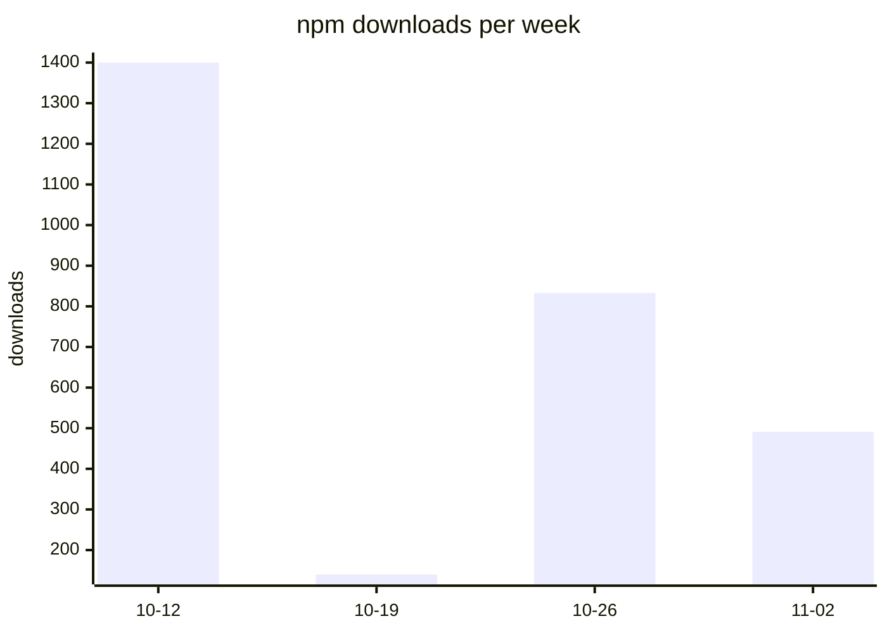

# Usage stats

Updated 2026-11-13 by the Usage stats workflow on `main`. The counts are what npm and GitHub publish; nothing is collected from the server or its users.

| | Last 7 days | Last 30 days |
| --- | --- | --- |
| npm downloads | 766 | 3498 |
| Repository views | 941 | — |
| Repository clones | 539 | — |

Claude Desktop extension downloads, all releases: 293.

npm counts every download, including CI runs, mirrors and repeated `npx` installs, so read them as a trend rather than a number of users. Daily unique visitors cannot be added up into unique visitors for a longer period.

Repository views per week: not enough complete weeks recorded yet.

Files: `npm-downloads.csv`, `github-traffic.csv`, `referrers.csv` (the 14-day window as recorded each day), `extension-downloads.csv` (running totals per release).
