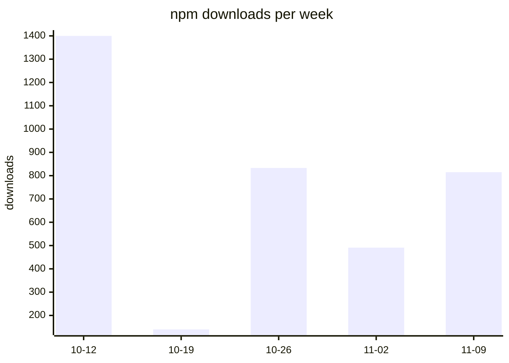

# Usage stats

Updated 2026-11-18 by the Usage stats workflow on `main`. The counts are what npm and GitHub publish; nothing is collected from the server or its users.

| | Last 7 days | Last 30 days |
| --- | --- | --- |
| npm downloads | 979 | 2707 |
| Repository views | 450 | — |
| Repository clones | 635 | — |

A dash means coverage is incomplete. Each total covers full UTC days through yesterday.

Claude Desktop extension downloads, all releases: 334.

npm counts every download, including CI runs, mirrors and repeated `npx` installs, so read them as a trend rather than a number of users. Daily unique visitors cannot be added up into unique visitors for a longer period.

## GitHub reach and referrers

GitHub’s rolling 14-day window, recorded on 2026-11-18 (UTC).

Unique repository visitors: 340. Unique cloners: 288.

| Top referring sites | Views | Unique visitors |
| --- | ---: | ---: |
| reddit.com | 108 | 79 |
| github.com | 68 | 16 |
| com.reddit.frontpage | 66 | 52 |
| Google | 25 | 23 |
| t.co | 16 | 13 |
| teams.public.onecdn.static.microsoft | 15 | 14 |
| Bing | 4 | 2 |
| DuckDuckGo | 1 | 1 |
| npmjs.com | 1 | 1 |

Repository views per week: not enough complete weeks recorded yet.

Files: `npm-downloads.csv`, `github-traffic.csv`, `github-traffic-windows.csv` and `referrers.csv` (14-day snapshots), `extension-downloads.csv` (running totals per release).
