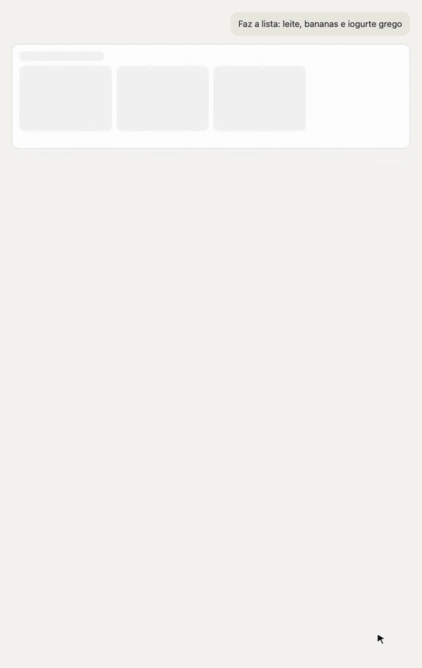

# Continente MCP

[](https://github.com/andredelgado/continente-mcp/actions/workflows/ci.yml)
[](https://www.npmjs.com/package/continentept-mcp)
[](LICENSE)

An [MCP](https://modelcontextprotocol.io) server that lets AI assistants shop at
[Continente.pt](https://www.continente.pt): search products, check prices and sale rules,
read your favorites and past orders, and fill your cart. Checkout and payment always stay
on the website.

<p align="center">
  
</p>

> **Unofficial.** This project is not affiliated with, endorsed by or supported by
> Continente or MC Sonae. It automates the public website with a headless browser, may break
> when the site changes, and should be used in line with the website's terms. You are
> responsible for anything placed in your cart.

## Try it without an account

Search, prices and product details need no Continente account. With Node.js 22 or newer, add
the server to your MCP client with no credentials at all. In Claude Code:

```sh
claude mcp add continente -- npx -y continentept-mcp
```

Other clients use the JSON under [Manual setup](#manual-setup-any-mcp-client), step 2. Then ask:

> Compare three laundry detergents by price per wash, without changing the cart.

Favorites, orders, coupons and the cart need your account; add it when you want them. The
Claude Desktop extension asks for your email and password when you install it.

## Features

- **Catalogue search and product details**, with exact prices, unit prices, promotions,
  availability and sale rules for weighted and bulk products.
- **Choose with photos.** When there is more than one good match, the assistant shows the
  options side by side and you pick, in clients that support MCP Apps.
- **Labels**: ingredients, allergens and nutrition as the label declares them.
- **Safe cart changes.** Preview a list before applying it, with the minimum order and
  delivery shown. Every change is confirmed by reading the cart back, and one that cannot be
  confirmed is never retried.
- **Your account**: favorites, order history, the products you buy most, and your Cartão
  Continente coupons.
- **No checkout.** The browser the server drives blocks payment, order submission and slot
  booking, so those always happen on the website, by you.
- **Runs locally** over stdio. Your credentials and session are stored on your computer and
  sent only to Continente.pt.
- **Built-in guidance.** The server tells the assistant the cart rules as soon as it
  connects, and offers a [`basket-planner`](docs/tools.md#instructions-and-prompt) prompt and
  skill with the full shopping workflow.

## Requirements

- A Continente.pt account for account features (search and product details work without one)
- Claude Desktop on macOS or Windows for the one-click install, or Node.js 22 or newer for
  any other MCP client

The server drives the website with Chromium, which it downloads automatically the first time
it needs it (about 150 MB, once).

## What it can access

When you install the extension, Claude Desktop warns that it will have access to everything on
your computer. That warning appears for every extension installed from a file: an extension
runs as an ordinary program with your user's permissions, and Claude cannot check what each one
does. Here is what this one does:

- **Files:** it reads and writes its own folder, `~/.continentept-mcp` (the website session,
  your favorites list and the date of the last update check), a credentials file if you set
  one up, and the Chromium it downloads, which lives in Playwright's cache folder. It does not
  read your documents, photos or other files.
- **Network:** it talks to continente.pt, and to npm once a day to see whether a new release is
  out. The first time it needs a browser it downloads Chromium from Playwright's servers.
- **Browser:** it only opens continente.pt pages. Those pages load their usual images and
  scripts, as they would in your own browser. Payment, order submission and delivery-slot
  booking are blocked.
- **Credentials:** your email and password are sent only to continente.pt to sign in. With the
  extension, Claude Desktop keeps them in its secure settings storage.

You don't have to take this on trust: the code is all [here](src), and every npm release is
published by GitHub Actions with [provenance](https://docs.npmjs.com/generating-provenance-statements),
so you can check it was built from this repository. The extension file is built by the same
workflow. [Configuration](docs/configuration.md#stored-data)
lists every stored file.

## Install in Claude Desktop (one click)

1. Download [**continente-mcp.mcpb**](https://github.com/andredelgado/continente-mcp/releases/latest/download/continente-mcp.mcpb)
   from the latest release.
2. Open it. Claude Desktop shows an install dialog; click **Install**.
3. Enter your Continente email and password when asked. Claude Desktop keeps the password
   in its secure settings storage.

If opening the file does nothing, install it from inside Claude Desktop: go to **Settings >
Desktop app** and select **Manage** next to **Extensions** (**Settings > Extensions** in the
older layout), click **Advanced settings**, then **Install Extension…** and pick the file.
These are the steps in
[Claude's guide to local MCP servers](https://support.claude.com/en/articles/10949351-getting-started-with-local-mcp-servers-on-claude-desktop).

To update, download the new `continente-mcp.mcpb` and open it; your email and password are
kept. The assistant tells you when a new release is out
([how updates work](docs/configuration.md#updates)). To use 1Password instead of storing the
password in Claude Desktop, use the manual setup below.

## Manual setup (any MCP client)

**1. Save your credentials** in a private file, `~/.continentept-mcp/credentials.env` (see
[configuration](docs/configuration.md) for other options). Skip this step if you only want
search and product details.

Create the file first, then type your password in an editor, so it never passes through your
shell history. On macOS and Linux:

```sh
mkdir -p ~/.continentept-mcp && chmod 700 ~/.continentept-mcp
touch ~/.continentept-mcp/credentials.env && chmod 600 ~/.continentept-mcp/credentials.env
${EDITOR:-nano} ~/.continentept-mcp/credentials.env
```

On Windows, in PowerShell (Notepad offers to create the file):

```powershell
New-Item -ItemType Directory -Force "$env:USERPROFILE\.continentept-mcp" | Out-Null
icacls "$env:USERPROFILE\.continentept-mcp" /inheritance:r /grant:r "${env:USERNAME}:(OI)(CI)F"
notepad "$env:USERPROFILE\.continentept-mcp\credentials.env"
```

Put these two lines in it and save:

```sh
CONTINENTE_EMAIL=you@example.com
CONTINENTE_PASSWORD=your-password
```

Using 1Password? Skip the file and pass secret references through `op run` instead; see
[Using 1Password](docs/configuration.md#using-1password).

Optionally check that login works:

```sh
npx -y continentept-mcp login
```

**2. Add the server to your MCP client.**

Claude Code:

```sh
claude mcp add continente -- npx -y continentept-mcp
```

Claude Desktop, Cursor and other clients (`claude_desktop_config.json`, `mcp.json`, ...):

```json
{
  "mcpServers": {
    "continente": {
      "command": "npx",
      "args": ["-y", "continentept-mcp"]
    }
  }
}
```

To keep the credentials file elsewhere, add
`"env": { "CONTINENTE_CREDENTIALS_FILE": "/absolute/path/to/credentials.env" }`.

Chromium downloads itself on first use. To fetch it ahead of time, run
`npx -y continentept-mcp install-browser` (on Linux, add `--with-deps` for the system
libraries it needs).

**3. Ask your assistant** something like *"Add semi-skimmed milk and a dozen eggs to my
Continente cart"* or *"What do I usually buy? Build me a list for this week."*

The server is also listed in the [MCP Registry](https://registry.modelcontextprotocol.io) as
`io.github.andredelgado/continente-mcp`.

### Docker (build from source)

The repository has a `Dockerfile`, but no image is published yet, so you build it yourself.
[Configuration](docs/configuration.md#docker-build-from-source) has the commands, the `/data`
volume and how to sign in on a machine without a screen.

## Tools

| Tool | What it does |
| --- | --- |
| `search_products` | Search the catalogue in relevance order, with favorites marked and a cursor for more |
| `get_product` | Price, pack size, availability and sale rules for one product |
| `get_product_labels` | Ingredients, allergens and nutrition as the label declares them |
| `choose_products` | Let the user pick between products, with photos where the client supports it |
| `list_favorites` | Your saved favorites (`refresh: true` fetches the latest) |
| `get_cart` | Cart lines, quantities, bags and totals |
| `preview_cart_changes` | What a list of changes would do and cost, without changing the cart |
| `add_cart_item` | Add an amount on top of what is in the cart |
| `set_cart_item_quantity` | Make the cart hold exactly a quantity; zero removes |
| `remove_cart_item` | Remove a line from the cart |
| `clear_cart` | Empty the whole cart in one confirmed step |
| `list_coupons` | Your Cartão Continente coupons, and which are selected in the cart |
| `set_cart_coupons` | Choose which coupons the cart uses, confirmed by reading the cart back |
| `list_orders` | Recent orders with their product lines |
| `get_order` | One order's product lines |
| `list_frequently_bought_products` | Products ranked by how often you order them |
| `get_session_status` | Local login, cookie and cache state (no network) |

See the [tool reference](docs/tools.md) for inputs, outputs, error codes, uncertain cart
changes and limits.

## Command line

```text
continentept-mcp                    Start the MCP server on stdio
continentept-mcp login              Sign in and save the session (--show-browser to watch)
continentept-mcp install-browser    Download Chromium now instead of on first use (extra arguments go to Playwright)
continentept-mcp --version
```

## Limitations

- One account per server process.
- Searches read at most five result pages and order listings at most ten pages, so very
  broad queries or long histories are reported as incomplete rather than read in full.
- When Continente asks you to confirm you are not a robot, you tick the box yourself in a
  sign-in window the server opens ([details](docs/configuration.md#não-sou-um-robô)). The
  server never answers that check.
- There are no checkout, payment, delivery-slot or favorites-editing tools.

## Documentation

- [Tool reference](docs/tools.md)
- [Stability](docs/stability.md): what counts as a breaking change from 1.0
- [Configuration](docs/configuration.md)
- [Troubleshooting](docs/troubleshooting.md)
- [Contributing](CONTRIBUTING.md)
- [Security policy](SECURITY.md)
- [Changelog](CHANGELOG.md)

## License

[MIT](LICENSE)
