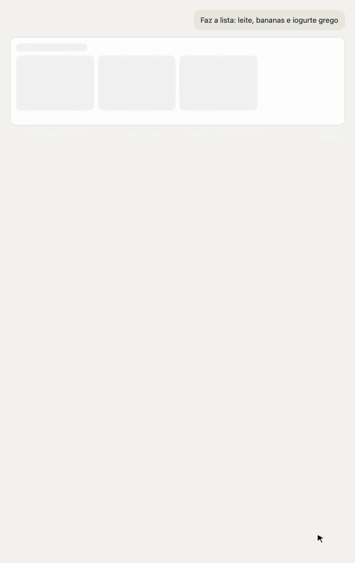

# Continente MCP

[](https://github.com/andredelgado/continente-mcp/actions/workflows/ci.yml)
[](https://www.npmjs.com/package/continentept-mcp)
[](LICENSE)

Connect your assistant to [Continente.pt](https://www.continente.pt) to compare groceries,
look up past orders and fill your cart. You choose a delivery slot and pay on the website.

<p align="center">
  
</p>

> **Unofficial.** This project is independent of Continente and MC Sonae. It uses the public
> website and may break when the site changes. The website's terms apply.

## Install

If your assistant can configure local MCP servers, install [Node.js 22 or newer](https://nodejs.org)
and paste this request into a chat. Claude Desktop also offers an extension in the table below.

```text
Install and configure Continente MCP for this client. Add a local stdio server
named continente that runs npx -y continentept-mcp. Keep my existing MCP servers
and settings. If its tools are already available, call get_session_status to
check the connection; otherwise tell me to restart the client first.
```

Restart the client if prompted, then try this in chat. A product search needs no account or API key.

> Search Continente for “leite meio-gordo” and show me three options with their prices per litre.

### Install manually

The `npx` options use Node.js 22 or newer. Claude Desktop includes Node.js for its
extension. Allow for a Chromium download on the first search (about 150 MB).

| Client | How |
| --- | --- |
| Claude Desktop (macOS or Windows) | Download [**continente-mcp.mcpb**](https://github.com/andredelgado/continente-mcp/releases/latest/download/continente-mcp.mcpb) and open it |
| Claude Code | `claude mcp add --scope user continente -- npx -y continentept-mcp` |
| VS Code | [](https://vscode.dev/redirect/mcp/install?name=continente&config=%7B%22type%22%3A%22stdio%22%2C%22command%22%3A%22npx%22%2C%22args%22%3A%5B%22-y%22%2C%22continentept-mcp%22%5D%7D) |
| Cursor | [](https://cursor.com/en/install-mcp?name=continente&config=eyJjb21tYW5kIjoibnB4IiwiYXJncyI6WyIteSIsImNvbnRpbmVudGVwdC1tY3AiXX0=) |
| LM Studio | [](https://lmstudio.ai/install-mcp?name=continente&config=eyJjb21tYW5kIjoibnB4IiwiYXJncyI6WyIteSIsImNvbnRpbmVudGVwdC1tY3AiXX0%3D) |
| ChatGPT desktop | Choose **STDIO** in **Settings > MCP servers > Add server**. [Command and arguments](docs/clients.md#chatgpt-desktop) |
| Codex CLI | `codex mcp add continente -- npx -y continentept-mcp` |
| Gemini CLI | `gemini mcp add -s user continente npx -- -y continentept-mcp` |
| Other apps and editors | [Client guide, including Cherry Studio and AnythingLLM](docs/clients.md) · [Docker](docs/configuration.md#docker) |

### Connect your Continente account

For favorites, past orders, coupons or your cart, enter your Continente email and password
in the Claude Desktop extension's settings, or create a [private credentials file](docs/configuration.md#credentials-file)
on the machine running the server. Restart the client after adding your credentials.

> Use my past orders to suggest a shopping list for this week. Show me the estimated cost.

## Features

- Compare pack prices, prices per kilo, litre or wash, and promotions. Check ingredients,
  allergens and nutrition as listed on the product label.
- Pick between products in chat. Clients that support MCP Apps show photos side by side.
  Other clients show a numbered list.
- Preview a list before adding it. The estimate shows progress toward the order minimum
  and whether EntregaZero covers delivery. Other delivery fees are set at checkout.
- Add or remove items and select Cartão Continente coupons. The server checks the result
  after each change. If it can't confirm what happened, it tells you and stops. Ask to see
  your cart or selected coupons to check.

## What it can access

Claude Desktop's extension warning reflects the permissions of a program running as your
user. Continente MCP signs in directly at Continente.pt. Your assistant receives the results
you request, including cart contents or past orders when you ask for them.

The server keeps the website session and cached favorites in `~/.continentept-mcp` by
default. Claude Desktop stores the extension password in its secure settings. A manual
credentials file stores it in plain text with access restricted to your user when you
follow the [file setup instructions](docs/configuration.md#credentials-file).

The browser opens Continente pages, which load their usual images and scripts. It blocks
order submission, payment and delivery-slot booking. The npm package and extension download
Chromium from Playwright on first use.
The server also checks npm for updates at most once a day. [Stored files](docs/configuration.md#stored-data)
· [Update settings](docs/configuration.md#update-check) · [Source code](src)

## Tools

The tool reference lists which tools need an account and which can change your cart or
coupons. Read-only mode was added after the 0.16.1 release. [Tool reference](docs/tools.md) ·
[Read-only mode](docs/configuration.md#read-only-mode)

## Command line

Run `npx -y continentept-mcp --help` to see the commands in your installed version.
You can [sign in from a terminal](docs/configuration.md#sign-in-and-saved-session) or
download Chromium ahead of time with `npx -y continentept-mcp install-browser`.

## Limitations

- One account per server process.
- Each search reads up to five result pages per call. Order listings read up to ten.
- When Continente asks you to confirm you are not a robot, you tick the box yourself in a
  sign-in window the server opens ([details](docs/configuration.md#não-sou-um-robô)). The
  server never answers that check.
- Edit your favorites on Continente.pt. The assistant can read your saved list.

## Documentation

- [Setup by client](docs/clients.md)
- [Configuration](docs/configuration.md)
- [Troubleshooting](docs/troubleshooting.md)
- [Stability](docs/stability.md)
- [Contributing](CONTRIBUTING.md)
- [Security policy](SECURITY.md)
- [Changelog](CHANGELOG.md)

## License

[MIT](LICENSE)
