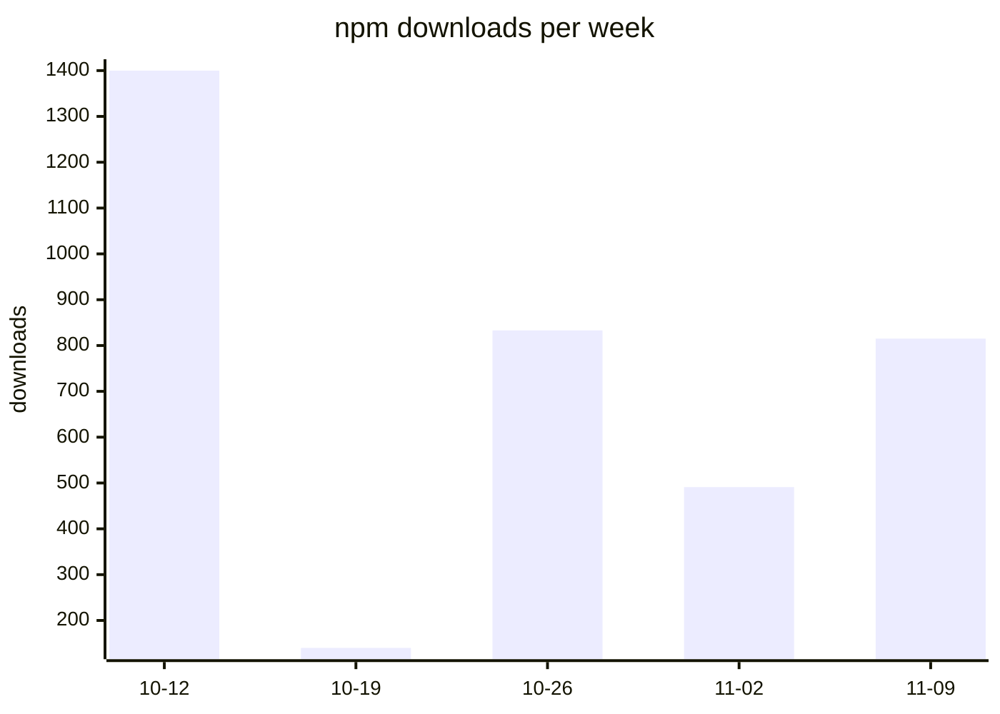

# Usage stats

Updated 2026-11-20 by the Usage stats workflow on `main`. The counts are what npm and GitHub publish; nothing is collected from the server or its users.

| | Last 7 days | Last 30 days |
| --- | --- | --- |
| npm downloads | 734 | 2832 |
| Repository views | 302 | — |
| Repository clones | 630 | — |

A dash means coverage is incomplete. Each total covers full UTC days through yesterday.

Claude Desktop extension downloads, all releases: 343.

Docker image downloads from ghcr.io, all versions: 100 (as of 2026-11-20).

npm counts every download, including CI runs, mirrors and repeated `npx` installs, and ghcr.io counts every image pull, so read them as a trend rather than a number of users. Daily unique visitors cannot be added up into unique visitors for a longer period.

## GitHub reach and referrers

GitHub’s rolling 14-day window, recorded on 2026-11-20 (UTC).

Unique repository visitors: 346. Unique cloners: 330.

| Top referring sites | Views | Unique visitors |
| --- | ---: | ---: |
| reddit.com | 111 | 83 |
| github.com | 69 | 16 |
| com.reddit.frontpage | 66 | 52 |
| Google | 25 | 23 |
| t.co | 16 | 13 |
| teams.public.onecdn.static.microsoft | 15 | 14 |
| Bing | 3 | 1 |
| DuckDuckGo | 1 | 1 |
| ecosia.org | 1 | 1 |
| npmjs.com | 1 | 1 |

Repository views per week: not enough complete weeks recorded yet.

Files: `npm-downloads.csv`, `github-traffic.csv`, `github-traffic-windows.csv` and `referrers.csv` (14-day snapshots), `extension-downloads.csv` (running totals per release), `image-downloads.csv` (running totals of the Docker image).
